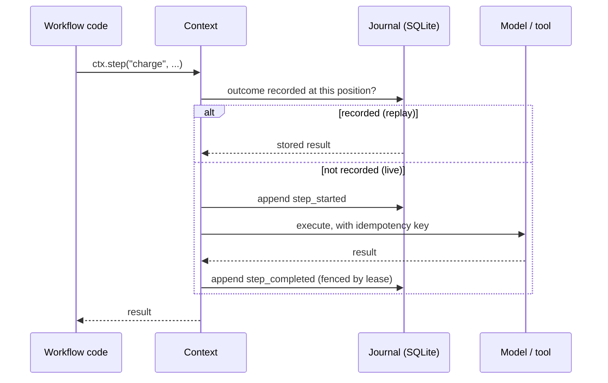

# Revenant

**A crash-proof, replayable runtime for AI agents.** Durable execution, human approval gates, hard budgets and time-travel forks, on a single SQLite file with zero dependencies.

[](../../actions/workflows/ci.yml)


Agents are long-running programs that spend money and touch real systems. When one dies at step 14 of 20 (a deploy, an OOM kill, a rate limit, a laptop lid), most frameworks start over: they pay for the same completions again and repeat side effects that already happened.

Revenant journals every model call, tool call, timer and human decision. A run can be killed at any instruction and continued by any other process, from exactly where it stopped, without repeating finished work.

```python
from revenant import Runtime, ScriptedModel, run_agent, tool, workflow

@tool(requires_approval=True)
def issue_refund(order_id: str, amount: float, idempotency_key: str = "") -> dict:
    """Refund money to the customer."""
    return payments.refund(order_id, amount, idempotency_key=idempotency_key)

@workflow(name="support")
def support(ctx, ticket):
    return run_agent(ctx, model, [lookup_order, issue_refund], ticket)

rt = Runtime("agents.db")
run = rt.start(support, "Order A-1042 arrived broken.")   # -> suspended, waiting for approval
# ...the process can exit here; hours later, from anywhere:
rt.approve(run.run_id)                                     # -> completed
```

## What you get

| | |
|---|---|
| **Crash recovery** | Kill the process at any point. Another worker resumes from the journal; completed steps are never re-executed. |
| **No double spend** | Model responses are journaled with their token usage and cost. A resumed run does not pay for the same completion twice. |
| **Human-in-the-loop** | `requires_approval=True` parks the run, with no process alive, until someone approves or denies. |
| **Hard budgets** | Token, cost, LLM-call and step limits per run, enforced before each call and identically on replay. |
| **Time travel** | Fork any run from any event. The shared prefix replays for free; only the new branch executes. Retry a failed run after fixing the bug, or explore "what if the reviewer had said no". |
| **Durable timers** | `ctx.sleep(86_400)` survives restarts. |
| **Retries** | Exponential backoff with deterministic jitter, per step or per tool. |
| **Safe concurrency** | Leases with fencing: a worker presumed dead that wakes up late cannot corrupt a run that was taken over. |
| **Observability** | Every run exports as an OpenTelemetry trace (OTLP/JSON, GenAI semantic conventions). A CLI shows the full timeline. |
| **Change detection** | If workflow code no longer matches a run's history, the run is parked with a precise error instead of silently diverging. |

## See it survive `kill -9`

```bash
pip install -e .
python examples/crash_recovery.py
```

```text
1. Worker A starts the pipeline and is killed mid-step:
    [pid 313] executing fetch-orders
    [pid 313] executing compute-totals
    [pid 313] executing charge-card
    [pid 313] power cut: SIGKILL during charge-card
    worker A exit code: -9 (killed)

2. Worker B polls the journal. Once A's lease lapses it takes the run over:
    [pid 312] executing charge-card
    [pid 312] executing send-receipt

3. Result: ['fetch-orders: done', 'compute-totals: done', 'charge-card: done', 'send-receipt: done']

4. Side effects that actually happened (step, idempotency key):
    fetch-orders    invoice-run:1
    compute-totals  invoice-run:3
    charge-card     invoice-run:5
    charge-card     invoice-run:5
    send-receipt    invoice-run:7
```

The two finished steps ran once. `charge-card` was in flight when the worker died, so it ran again under the **same idempotency key**, which is what lets a payment API deduplicate it.

`python -m examples.support_agent` shows the agent side: an approval gate, then a fork that replays the same conversation and denies the refund instead, spending zero new tokens on the shared prefix.

## How it works

A workflow is ordinary Python. It becomes durable because every side effect goes through the context:

```python
@workflow(name="report")
def report(ctx, topic):
    sources = ctx.step("search", search_web, topic)          # journaled
    draft = ctx.llm(model, [{"role": "user", "content": f"Summarise: {sources}"}])
    ctx.sleep(3600, "embargo")                                # durable timer
    verdict = ctx.wait_signal("editor-review")                # waits for a human
    return ctx.step("publish", publish, draft["content"]) if verdict["ok"] else None
```

On resume the function runs again from the top. Each `ctx` call first looks at the journal: if an outcome is recorded at that position it is returned immediately, otherwise the operation executes and its outcome is appended. Replay fast-forwards through history and goes live at the first unrecorded operation.



### Guarantees, stated precisely

- **A journaled result is never recomputed.** Once `step_completed` is written, that step is not executed again for that run.
- **Steps are at-least-once.** A step that was executing when its worker died runs again. It receives the same `idempotency_key`, so effects on systems that honour such keys are effectively exactly-once.
- **One writer per run.** Each append verifies lease ownership in the same transaction, and `(run_id, seq)` is unique, so a fenced-off worker's writes are rejected.
- **Determinism is checked, not assumed.** Each operation is fingerprinted (kind, name, arguments). A mismatch on replay raises `NonDeterminismError` and parks the run as `stalled`; it resumes once the code is fixed.

The rule a workflow must follow: side effects and non-determinism (time, randomness, I/O) go through `ctx`. Use `ctx.now()`, `ctx.random()`, `ctx.uuid()` instead of the standard-library calls.

## Verification

The interesting claims are tested, not asserted:

- **Exhaustive crash injection** (`tests/test_chaos.py`): for a workflow mixing steps, a retried step, a timer, a signal and recorded time, the suite crashes the runtime before *every* journal write, and before *every pair* of writes, restarts on a fresh runtime each time, and checks that the final result equals the crash-free result and that every external effect is committed exactly once per idempotency key.
- **Real process death** (`tests/test_sigkill.py`): a worker process is killed with `SIGKILL` mid-step and a second process recovers the run.
- **Fencing** (`tests/test_runtime.py`): a worker stalls inside a step, loses its lease, another worker completes the run, and the first worker's late write is rejected.
- **Provider adapter**: the OpenAI-compatible client is tested against a local HTTP server, including retry on 5xx and wire-format round-tripping of tool calls.

```bash
pip install -e ".[dev]"
pytest            # 46 tests
ruff check .
mypy              # strict
```

## CLI

```text
$ revenant --db support_demo.db show efb9c80ec499
run       efb9c80ec49946938cd0ee12f7636f21
workflow  examples.support_agent
status    completed
usage     3 llm call(s), 458 tokens, $0.002370, 5 step(s)

  #0   +   0.000s  run_started         input=Order A-1042 arrived broken. I want my money back.
  #1   +   0.000s  step_started        llm  model=scripted-support-model
  #2   +   0.000s  step_completed      llm  tokens=42+28  tool_calls=lookup_order  content=Let me look up that order.
  #3   +   0.000s  step_started        tool:lookup_order
  #4   +   0.000s  step_completed      tool:lookup_order  -> {"customer": "dana@example.com", "status": "delivered", "total": 89.9}
  ...
  #7   +   0.001s  signal_waiting      approve:call_1_0  details={"arguments": {"amount": 89.9, "order_id": "A-1042"}, "tool": "issue_refund"}
  #8   +   0.002s  signal_received     approve:call_1_0  payload={"approved": true, "reason": "photos confirm damage"}
  #9   +   0.002s  step_started        tool:issue_refund
  ...
```

| Command | Purpose |
|---|---|
| `revenant runs [--status S]` | List runs |
| `revenant show RUN [--json]` | Timeline of a run (id prefixes work) |
| `revenant resume RUN [--force]` | Continue a run; `--force` takes over from a dead worker |
| `revenant approve RUN [--deny] [--reason TEXT]` | Answer a pending approval |
| `revenant signal RUN NAME [--payload JSON]` | Deliver any signal |
| `revenant fork RUN [--at SEQ] [--resume]` | Branch a new run from an earlier point |
| `revenant export RUN [-o FILE]` | OpenTelemetry trace (OTLP/JSON) |
| `revenant worker [--once]` | Drive due runs: new, timers, signals, crashed |

Pass `-i MODULE` so the CLI can import your workflows, for example `revenant -i examples.support_agent approve <run>`.

## Using a real model

`OpenAICompatibleModel` speaks the Chat Completions protocol using only the standard library, so it works with hosted APIs and local servers alike:

```python
from revenant import OpenAICompatibleModel

model = OpenAICompatibleModel(
    "gpt-4o-mini",
    base_url="https://api.openai.com/v1",   # or http://localhost:11434/v1, etc.
    input_price=0.15, output_price=0.60,     # USD per million tokens, for cost budgets
)
```

See `examples/live_agent.py`. Any object with a `name` and a `complete(messages, tools)` method is a model; providers must be stateless (derive the reply from the messages they are given).

## Performance

`python benchmarks/overhead.py`, one run on a shared Linux x86-64 container, CPython 3.13. Treat as an order of magnitude; your disk decides.

| Durability | Live | Overhead per step | Replay |
|---|---|---|---|
| `normal` (default) | ~10,000 steps/s | ~0.1 ms | ~70,000 steps/s |
| `full` (fsync each write) | ~2,500 steps/s | ~0.4 ms | ~100,000 steps/s |

A model call takes hundreds of milliseconds, so journaling is noise. `normal` survives process crashes; an OS crash or power loss can drop the last few writes, which only means the affected step runs again. `Runtime(path, durability="full")` closes that window.

## Limitations

- Steps inside one run execute sequentially; there is no parallel fan-out within a workflow yet. Many runs can execute concurrently across workers.
- SQLite means one machine (or a shared volume with working file locks). The journal sits behind a small class, so a Postgres backend is a contained change.
- Step inputs and results must be JSON-serialisable.
- `wait_signal` has no timeout yet; combine with an operator-side deadline.
- The OpenAI-compatible adapter is tested against a local stub server, not against every hosted provider.

## Project layout

```text
src/revenant/
  journal.py    append-only event store, leases, fencing, signals, forks
  context.py    replay engine: steps, timers, signals, LLM and tool calls
  runtime.py    start / resume / fork / approve, worker loop, heartbeats
  agent.py      @tool schema generation and the durable agent loop
  models.py     ScriptedModel and OpenAICompatibleModel
  policy.py     RetryPolicy, Budget, Usage
  export.py     OpenTelemetry (OTLP/JSON) trace export
  cli.py        revenant command
```

Design notes are in [docs/DESIGN.md](docs/DESIGN.md).

## License

MIT
